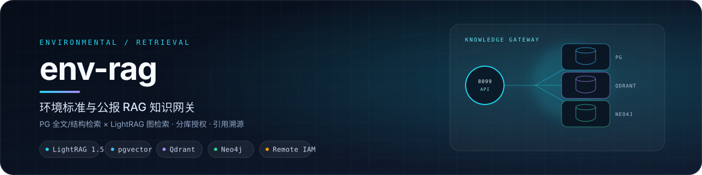
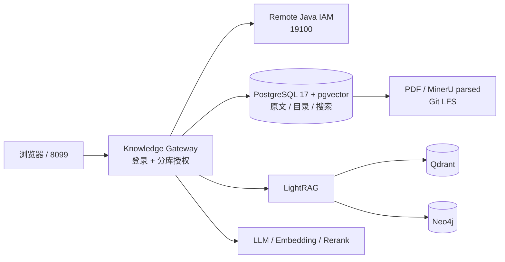

<p align="center">
  
</p>

<p align="center">
  
  
  
  
  
  
</p>

<p align="center">
  面向环境标准与公报的 RAG 知识网关：PG 全文/结构检索 × LightRAG 图检索，分库授权、引用溯源与来源下载。
</p>

<p align="center">
  <a href="#核心能力">核心能力</a> ·
  <a href="#架构">架构</a> ·
  <a href="#技术栈">技术栈</a> ·
  <a href="#快速开始">快速开始</a> ·
  <a href="#文档">文档</a>
</p>

# env-rag

环境知识库：230 份中外环境标准/公报 PDF（大气、水），提供两条互相独立又可组合的检索路径。

## 核心能力

- **PG 文档与范围检索**：PostgreSQL + pgvector 上的关键词检索、元数据过滤，以及不依赖模型总结的**表格/条款完整清单枚举**（解决“表查全了没有”的问题）。
- **LightRAG 图检索**：`lightrag-hku`（1.5.x）+ Qdrant 向量库 + Neo4j 图谱，支持 naive/local/global/hybrid/mix 模式，以及两路融合与精排的工程实现。
- **分库授权网关**：8099 网页按账号决定可查资料空间，支持选库、完整清单、带引用回答、证据过期/范围歧义时停止生成、来源全文与 PDF 下载、个人历史。
- **可审计边界**：身份实时核验自远程 IAM；检索结果保留 `complete/retrieved/stale/partial/ambiguous/missing` 状态，不以 HTTP 200 代替业务成功。

## 技术栈

| 层 | 选型 | 说明 |
|---|---|---|
| 检索与存储 | PostgreSQL 17 + pgvector · Qdrant · Neo4j | 原文/目录、向量索引与知识图谱各司其职 |
| 图检索 | LightRAG 1.5（`lightrag-hku`） | naive/local/global/hybrid/mix 与融合精排 |
| 服务 | Python 3.12 · aiohttp · httpx | 8099 知识网关、CLI 与后台任务 |
| 模型 | OpenAI 兼容 LLM · Embedding/Rerank | 生成、抽取与检索打分分离配置 |
| 身份 | 独立 Java IAM（remote auth） | 实时核验、分库授权、故障不回退本地账号 |
| 数据 | 230 份 PDF · MinerU 解析 · Git LFS | 原文、切分与金标随仓库版本管理 |

## 架构



## 三仓关系

| 仓库 | 职责 |
|---|---|
| [air-agent](https://github.com/Acerola-1/air-agent) | Agent 运行时、聊天前端与运营后台 |
| **env-rag**（本仓） | 环境标准/公报知识库、检索与 8099 网关 |
| [air_agent_iam](https://github.com/Acerola-1/air_agent_iam) | 多租户身份、会话与业务授权 |

## 快速开始

以下以 macOS + Apple Container 为例。

### 1. 准备依赖服务

Python 3.12，用 [uv](https://docs.astral.sh/uv/) 安装依赖；大文件走 Git LFS：

```bash
git lfs install
uv sync --locked
cp .env.example .env      # 然后填写自己的服务配置
```

后端三个存储运行在本机容器里（现场使用 Apple Container，其他机器可用 [deployment/docker-compose.workspaces.yml](deployment/docker-compose.workspaces.yml) 模板，未在本机以 Docker 验证）：

| 服务 | 默认地址 | 用途 |
| --- | --- | --- |
| PostgreSQL + pgvector | 127.0.0.1:5432 | 原文 chunks、目录与搜索索引（自有 `env_rag` schema） |
| Qdrant | http://127.0.0.1:6333 | 向量索引 |
| Neo4j | bolt://127.0.0.1:7687 | 知识图谱 |
| LLM 兼容端点 | http://127.0.0.1:7863/v1 | 生成/抽取模型（OpenAI 兼容协议） |
| Embedding/Rerank | https://api.siliconflow.cn | 需自行配置 API key |

应用本身是纯 Python 进程，与容器运行时无关——只要这些端口和库里数据就绪即可；但数据在容器卷内，没有后端就没有可检索内容。

### 2. 启动网关

需要与 Agent、IAM 三仓联调时，从 Agent 仓执行统一启动器：

```bash
../../air_agent/.venv/bin/python ../../air_agent/deployment/run_separated_local.py start
```

只启动本仓网关时，按 `.env.example` 注入身份与存储配置后运行：

```bash
python -m env_rag_final.access --auth-mode remote --port 8099
```

### 3. 登录试用

打开 <http://127.0.0.1:8099>，使用 IAM 账号登录。账号与权限由统一 IAM 管理；`ACCOUNTS.md` 仅说明账号用途，不保存秘密。

### 4. 自检与测试

```bash
uv run env-rag-final doctor --connections    # PG/Qdrant/Neo4j 只读连通检查
PYTHONDONTWRITEBYTECODE=1 uv run python -m pytest tests -q
uv run ruff check src tests scripts
```

## 常用命令

```bash
# 纯 PG 完整清单（不需要模型、不需要 LightRAG，只需 .env 里 5 个 POSTGRES_*）
uv run env-rag-final ask --query '列出 GB8978-1996 表1的全部项目及限值'

# 账号/成员/角色由统一 IAM 管理。

# 入库（可中断重跑，已完成的文档不重复计费）
uv run env-rag-final workspace-ingest --workspace air --dry-run
uv run env-rag-final workspace-catalog --workspace air
uv run env-rag-final workspace-index  --workspace air
```

全部命令见 `uv run env-rag-final --help`；历史评测期的命令语义表保存在 `reports/` 对应轮次目录。

## 仓库结构

| 路径 | 内容 |
| --- | --- |
| `src/env_rag_final/` | 应用代码：`access/`（8099 网关与网页）、`web/`（旧对照网页）、检索、枚举、入库、评测 |
| `datasets/` | 230 份 PDF 与 MinerU 解析产物（Git LFS）、固定金标、SHA 清单 |
| `deployment/` | Apple Container 实例脚本配置、Docker Compose 模板、注册表模板 |
| `scripts/` | workspace 引导、入库、验收与巡检脚本 |
| `docs/initialization/` | 当前有效的入库与发布边界说明 |
| `assets/` | **历史探究归档**：旧对照网页、PG 检索研究、整理记录（详见 [assets/README.md](assets/README.md)） |
| `reports/` | 各轮评测与验收证据（400MB+，按代次目录自组织，历史轮次保持原样） |
| `openspec/` | 规格驱动的变更计划；已完成的在 `openspec/changes/archive/` |
| `.local/` | 本机运行状态（不进 Git）：注册表、实例密钥、记录、入库账本 |

## 文档

| 文档 | 内容 |
|---|---|
| [AGENTS.md](AGENTS.md) | 项目事实、运行边界与提交约定 |
| [WORKSPACE-ACCESS.md](WORKSPACE-ACCESS.md) | 8099 网关、分库授权与账号说明 |
| [docs/initialization/](docs/initialization/) | 入库、发布与数据边界 |
| [reports/pg-retrieval/](reports/pg-retrieval/) | 固定金标、Gate 4 结论与评测证据 |
| [openspec/](openspec/) | 规格驱动的变更与归档 |

## 数据与质量边界（重要）

- 数据库、向量、图谱、缓存、`.env` 和密钥**不入 Git**；数据库是运行时派生数据，重建不能保证逐字复现历史 LLM 图谱。入库/重建边界见 [docs/initialization/INGESTION.md](docs/initialization/INGESTION.md)，发布边界见 [docs/initialization/PUBLISHING.md](docs/initialization/PUBLISHING.md)。
- 正式身份和授权由远程 IAM 实时核验；知识目录与数据库/向量/图的资料范围共同约束读路径。IAM 故障不回退本地账号。
- 评测结论：固定金标为 31 正例 / 10 反例；**Gate 4 未通过，默认融合未启用**——工程可运行不代表检索质量已达标。完整证据在 `reports/pg-retrieval/`。
- 语料默认定位 `datasets/corpus/parsed`，可用环境变量 `ENV_RAG_PARSED_ROOT` 或 `ENV_RAG_DATA_DIR` 覆盖。

## 分支

`dev` 为开发分支，`main` 为稳定分支。命令名保留 `env-rag-final` 以兼容既有脚本。

## 维护者说明

本机正式运行态、端口、容器与数据库清单以 [docs/CURRENT-RUNTIME.md](docs/CURRENT-RUNTIME.md) 为准；README 只保留公开使用与开发说明。历史评测与验收报告仍保存在 [reports/](reports/) 与 [assets/](assets/)，用于溯源，不代表当前部署状态。

## License

代码采用 [MIT](LICENSE)。`datasets/` 中的标准/公报 PDF 版权归原发布机构，仅用于检索研究，不随 MIT 重新授权。
